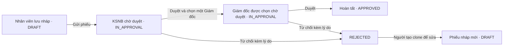

# Kế hoạch: Nhân viên → Kiểm soát nội bộ → Giám đốc

Ngày khảo sát: 21/10/2026. Source đối chiếu: commit `00afcd5`.

Trạng thái: **đã thực hiện Bước 1–2; Bước 3–6 chưa triển khai**. Kết quả kiểm thử và giới hạn hiện tại ở mục 11. Các mục khảo sát dưới đây ghi nhận source tại commit `00afcd5`, trước thay đổi Bước 1–2.

## 1. Kết luận khảo sát ban đầu

**Source tại thời điểm khảo sát chưa đáp ứng đúng quy trình mới cho nhân viên nói chung.** Đã có các thành phần để tái sử dụng, nhưng chưa có workflow chỉ gồm hai bước duyệt `INTERNAL_CONTROL → BOD`.

| Workflow hiện có | Các bước duyệt sau khi nhân viên gửi phiếu | Khác yêu cầu mới |
| --- | --- | --- |
| `NORMAL` | Trưởng phòng → KSNB → BGĐ | Vẫn có Trưởng phòng |
| `SPECIAL_1` | Trưởng phòng → KSNB → BGĐ 1 → BGĐ 2 | Có Trưởng phòng và hai lượt BGĐ |
| `SPECIAL_2` | Trưởng phòng → Khối Mua Hàng → KSNB → BGĐ | Có hai cấp trung gian |
| `SPECIAL_3` | Trưởng phòng → Ban Kỹ thuật → KSNB → BGĐ | Có hai cấp trung gian |
| `URGENT` | Trưởng phòng → BGĐ | Bỏ KSNB, không bỏ Trưởng phòng |
| `SPECIAL_4` | KSNB → BGĐ 1 → BGĐ 2 | Bỏ Trưởng phòng nhưng vẫn có hai lượt BGĐ |

Nguồn: [cấu hình workflow](../config/vendor_report_workflows.php), đặc biệt `NORMAL` dòng 20 và `SPECIAL_4` dòng 132. Đã nạp trực tiếp file bằng PHP và so sánh thứ tự `step_key`: **0 workflow khớp chính xác** với `['INTERNAL_CONTROL', 'BOD']`.

Ngoài ra, [VendorReportWorkflowBuilder.php](../app/Services/VendorReportWorkflowBuilder.php#L37) vẫn bắt buộc `department.head_user_id` trước khi tạo bước duyệt. Vì vậy, kể cả workflow đã bỏ bước Trưởng phòng cũng không gửi được nếu phòng ban chưa gán Trưởng phòng.

Trường hợp chính Trưởng phòng tạo phiếu `NORMAL` rồi được tự duyệt bước của mình không giải quyết yêu cầu: bước `DEPT_HEAD` vẫn tồn tại và nhân viên thông thường vẫn phải qua bước này.

## 2. Phạm vi khảo sát và mức độ xác minh

- Đã đọc toàn văn **72 file Markdown** trước khi tạo tài liệu này: 22 tài liệu ứng dụng và 50 tài liệu trong `.agents/skills/`. Không tính tài liệu thư viện trong `vendor/`, `node_modules/` hoặc dữ liệu Git.
- Dùng skill local `codebase-design` để xác định phần logic nên tập trung; dùng `writing-for-agents` để tổ chức kế hoạch theo bằng chứng, công việc và tiêu chí hoàn thành.
- Chia việc cho các agent đọc tài liệu nghiệp vụ, tài liệu nền tảng, backend phiếu, frontend và phần hỗ trợ; kiểm tra lại trực tiếp các đường xử lý quyết định kết luận.
- Đã đối chiếu routes, requests, controllers, services, models, policies, resources, notifications, migrations/seeders, màn hình phiếu, dashboard, cấu hình build và bộ test hiện có.
- Kết luận dựa trên source và thực thi đọc cấu hình. **Chưa chạy luồng trên trình duyệt, chưa kiểm tra dữ liệu/role đang có trong DB triển khai, chưa chạy toàn bộ test suite.** Không thay đổi DB, không gửi email, không sửa source nghiệp vụ trong đợt khảo sát này.

### Tài liệu ứng dụng đã đọc

| Nhóm | File |
| --- | --- |
| Nghiệp vụ và kế hoạch | `vendor_report_system_design.md`, `IMPLEMENTATION_PLAN.md`, `DASHBOARD_DESIGN.md`, `dashboard_improvements_todo.md` |
| Tổng kết | `IMPLEMENTATION_COMPLETE.md`, `PROJECT_COMPLETE_SUMMARY.md`, `DONE.md`, `docs/FINAL_SUMMARY.md` |
| Nền tảng | `README.md`, `BOILERPLATE_README.md`, `API_DOCUMENTATION.md`, `LOGIN_ARCHITECTURE.md`, `GOOGLE_DRIVE_SETUP.md`, `IMPROVEMENT_RECOMMENDATIONS.md`, `DOCUMENTATION_INDEX.md` |
| Phân quyền | `README_ROLES.md`, `QUICK_START_ROLES.md`, `ROLES_PERMISSIONS_SUMMARY.md`, `ROLES_PERMISSIONS_GUIDE.md`, `CHANGELOG_ROLES.md`, `docs/USER_ROLE_INTEGRATION.md`, `docs/ROUTE_PROTECTION_IMPLEMENTATION.md` |

50 tài liệu skill gồm `SKILL.md` của 27 skill đã cài và 23 tài liệu hỗ trợ. Chúng là hướng dẫn làm việc của agent, không phải đặc tả nghiệp vụ ứng dụng.

### Những tài liệu không thể dùng làm bằng chứng triển khai hiện tại

- `vendor_report_system_design.md` và `IMPLEMENTATION_PLAN.md` chỉ mô tả năm workflow cũ; source đã có thêm `SPECIAL_4`.
- `IMPLEMENTATION_PLAN.md` dòng 38 nói purchasing admin chỉ theo dõi, nhưng ví dụ dòng 653 lại thêm bước `PURCHASING_ADMIN`. Source hiện tại và thiết kế nghiệp vụ xác định người này **không phải một cấp duyệt**.
- Các file `*COMPLETE*`, `DONE.md` và nhiều tài liệu role thuộc các mốc hoàn thiện boilerplate/RBAC; một số còn tên dự án Language Center. Không dùng các tuyên bố “100%” ở đó để kết luận workflow phiếu đã hoàn thiện.
- Quy ước frontend trong kế hoạch cũ có chỗ mâu thuẫn. Kế hoạch này theo source đang dùng, không sao chép nguyên mã minh họa cũ.

## 3. Framework, kiến trúc và style đang dùng

| Phần | Hiện trạng và quy ước cần giữ |
| --- | --- |
| Backend | PHP `^8.2`, Laravel `^12`, Eloquent; tên class PascalCase, method camelCase, field DB snake_case. Controllers gọi services cho submit/approve; Form Requests validate tạo/sửa; Policies kiểm tra quyền. |
| Frontend | Vue 3 với `<script setup>` JavaScript, Inertia 2; PrimeVue 4, theme Aura, layout SakaiVue; Tailwind 3/SCSS; Vite 7. Không cần thêm framework hoặc chuyển sang SPA/API riêng. |
| Giao tiếp | Routes web có session/auth; Inertia render props và redirect/flash sau mutation. `VendorReportService.js` bọc thao tác submit/approve/reject/clone; Create/Edit còn dùng `useForm` trực tiếp. |
| Phân quyền | Spatie Permission 6, user có nhiều role. Luồng phiếu thực tế dựa vào `VendorReportPolicy`, `current_step_id`, assignee và trạng thái; không chỉ dựa vào permission hiển thị nút. |
| Nhãn | Model cung cấp nhãn qua Resources và props. Riêng mô tả chuỗi workflow vẫn khai báo ở cả Create.vue và Edit.vue. |
| Lưu workflow | Config định nghĩa các bước; khi submit sinh bản ghi `vendor_report_approval_steps`. Report giữ `current_step_id`; người được chọn được lưu cụ thể trên bước kế tiếp. |
| Thông báo/audit | Spatie Activitylog 4; notifications gửi qua `mail` và `database`, có queue. Cần kiểm thử đúng người nhận và thời điểm commit transaction. |
| DB | Migration khai báo enum cho `vendor_reports.workflow_type`. Config hỗ trợ nhiều driver và mặc định SQLite; chưa xác minh driver của môi trường triển khai. |
| Kiểm thử | PHPUnit 11, `phpunit.xml` dùng SQLite `:memory:`. Hiện chỉ có test Example, UserManagement, RolePermission; chưa có test workflow phiếu hoặc script test frontend trong package.json. |

Nguồn nền tảng: [composer.json](../composer.json), [package.json](../package.json), [app.js](../resources/js/app.js), [vite.config.js](../vite.config.js), [phpunit.xml](../phpunit.xml).

Luồng hiện hành: tạo phiếu `DRAFT` → người tạo bấm gửi → sinh mã `YYYY/DEPT_CODE/SEQ` với sequence chung theo năm → tạo runtime steps → xét tự duyệt → thông báo người đến lượt. Khi duyệt, module duyệt cập nhật bước hiện tại và chuyển `current_step_id`; hết bước mới thành `APPROVED`. Từ chối kết thúc tại `REJECTED`, người tạo có thể tạo bản nháp sửa đổi bằng clone.

## 4. Yêu cầu đích và giả định lập kế hoạch

Yêu cầu đã xác định: nhân viên tạo phiếu; KSNB duyệt trước; một Giám đốc duyệt sau; không có bước duyệt Trưởng phòng.

Các lựa chọn dưới đây là **đề xuất để triển khai**, không phải các quyết định bổ sung đã được người dùng xác nhận:

| Nội dung | Mặc định đề xuất |
| --- | --- |
| Phạm vi áp dụng | Thêm loại workflow riêng để người tạo chọn, giữ sáu workflow hiện có. Không tự thay `NORMAL` hoặc `SPECIAL_4`. |
| Mã workflow mới | `INTERNAL_CONTROL_BOD`, nhãn “KSNB → Giám đốc (bỏ qua Trưởng phòng)”. Đây là mã mới dự kiến, chưa tồn tại trong source. |
| Giám đốc | Dùng role `bod` hiện có, không tạo role `director` mới. KSNB chọn một tài khoản BGĐ đang hoạt động khi duyệt. |
| Tạo và gửi | Giữ hai thao tác riêng: lưu nháp rồi gửi phiếu. Giữ yêu cầu ảnh báo cáo và ít nhất một báo giá khi tạo. |
| Phòng ban | Người tạo vẫn thuộc phòng ban hoạt động để xác định mã phiếu; workflow này không cần `head_user_id`. |
| Người KSNB | Giao cho nhóm `internal_control`; một người hợp lệ trong nhóm thực hiện bước KSNB. |
| Tự duyệt | Riêng workflow mới luôn có hai thao tác duyệt chủ động, kể cả người tạo kiêm vai trò KSNB/BGĐ. |
| Người kiêm nhiệm | Chưa thêm điều kiện ba người bắt buộc khác nhau. Nếu cần cấm tự duyệt hoặc cấm một người duyệt cả hai bước, phải bổ sung rule, danh sách lựa chọn và test tương ứng. |
| Quyền của Trưởng phòng | Bỏ bước duyệt không đồng nghĩa bỏ quyền xem phiếu cùng phòng hiện có. Trưởng phòng chỉ duyệt được nếu đồng thời có vai trò/assignment hợp lệ ở bước KSNB hoặc BGĐ. |

Nếu mục tiêu là áp dụng mặc định cho mọi phiếu hoặc chuyển các phiếu đang chờ sang quy trình mới, cần một đợt chuyển đổi riêng, có quy tắc đối với từng trạng thái. Kế hoạch này không tự thực hiện chuyển đổi đó.

### Trạng thái và chuyển bước



| Mốc | Dữ liệu bắt buộc |
| --- | --- |
| Sau submit | Đúng hai runtime steps: thứ tự 1 `INTERNAL_CONTROL`, thứ tự 2 `BOD`; cả hai `PENDING`; `current_step_id` trỏ bước 1. |
| Sau KSNB duyệt | Bước 1 `APPROVED`, lưu `acted_by`, `acted_at`, ghi chú và người BGĐ đã chọn; bước 2 gán đúng user đó; report vẫn `IN_APPROVAL`. |
| Sau BGĐ duyệt | Bước 2 `APPROVED`, report `APPROVED`, có `approved_at`, `current_step_id = null`. |
| Khi từ chối | Report `REJECTED`, có lý do/thời gian, `current_step_id = null`; không còn việc chờ duyệt của phiếu này. |

Không sinh bước `DEPT_HEAD`, kể cả dưới trạng thái `SKIPPED`; không sinh `BOD_1`/`BOD_2` cho workflow mới.

## 5. Khoảng thiếu trong source và phần có thể tái sử dụng

| Phát hiện | Bằng chứng | Xử lý trong kế hoạch |
| --- | --- | --- |
| Chưa có cấu hình hai bước | [config](../config/vendor_report_workflows.php#L132) | Thêm workflow mới. |
| Builder bắt Trưởng phòng vô điều kiện, submission đã kiểm tra có `DEPT_HEAD` mới bắt | [Builder:37](../app/Services/VendorReportWorkflowBuilder.php#L37), [Submission:43](../app/Services/VendorReportSubmissionService.php#L43) | Thống nhất validation dựa vào bước thật trong config. |
| Workflow bị giới hạn ở nhiều nơi | [migration:18](../database/migrations/2026_01_29_144127_01_create_vendor_reports_table.php#L18), [Store:36](../app/Http/Requests/StoreVendorReportRequest.php#L36), [Update:36](../app/Http/Requests/UpdateVendorReportRequest.php#L36), [Model:47](../app/Models/VendorReport.php#L47) | Migration mới, validation và hai danh sách nhãn phải cùng nhận mã mới. |
| Creator có role phù hợp có thể được tự duyệt, kể cả bước yêu cầu chọn người | [Submission:97](../app/Services/VendorReportSubmissionService.php#L97) | Workflow mới bỏ cơ chế auto-approve khi submit; giữ hành vi cũ cho workflow khác. |
| POST người duyệt kế tiếp chỉ kiểm tra ID tồn tại | [Controller:596](../app/Http/Controllers/VendorReportController.php#L596), [ApprovalService:79](../app/Services/VendorReportApprovalService.php#L79) | Kiểm tra đúng role, active, chưa soft-delete ngay tại backend trước mutation. |
| Danh sách người chọn trên UI đã lọc role/active | [Controller:380](../app/Http/Controllers/VendorReportController.php#L380) | Tái sử dụng, đồng bộ tiêu chí với backend. |
| Không có người BGĐ thì UI coi như không cần chọn | [Show.vue:647](../resources/js/Pages/VendorReports/Show.vue#L647) | Tách “bắt buộc chọn” khỏi “có lựa chọn”; hiển thị lỗi rõ và khóa nút duyệt khi danh sách trống. |
| User vừa requester vừa approver có thể mất phiếu trong danh sách | [Controller:104](../app/Http/Controllers/VendorReportController.php#L104) trả về trước nhánh KSNB/BGĐ | Kết hợp quyền xem phiếu của mình với phiếu đến lượt mình; kiểm thử nhiều role. |
| Dashboard suy ra bước hiện tại từ các bước trước đã duyệt | [DashboardService:225](../app/Services/DashboardService.php#L225), [DashboardService:317](../app/Services/DashboardService.php#L317) | Hiện có lọc bước trước, không phải hiển thị mọi PENDING; nên thống nhất thêm điều kiện report `IN_APPROVAL` và ID bước hiện tại. |
| Transition có transaction nhưng đọc/kiểm tra bước trước transaction, không khóa report | [ApprovalService:40](../app/Services/VendorReportApprovalService.php#L40) | Chống hai KSNB xử lý cùng một bước và submit lặp. |
| Timeline và bản in duyệt theo dữ liệu bước | [Show.vue:214](../resources/js/Pages/VendorReports/Show.vue#L214), [print:383](../resources/views/vendor-reports/print.blade.php#L383) | Tái sử dụng và kiểm thử với hai bước; không cần tạo màn hình mới. |

Quyền tạo hiện cho phép mọi user active có department, không chỉ role `requester` ([Policy:100](../app/Policies/VendorReportPolicy.php#L100)). Không thu hẹp quyền tạo ngoài yêu cầu. Các endpoint submit/approve/reject/clone và role KSNB/BGĐ đã có đủ để mở rộng.

## 6. Kế hoạch triển khai theo thứ tự

### Bước 1 — Chuẩn bị test mô tả đúng yêu cầu

Tạo `tests/Feature/VendorReportInternalControlBodWorkflowTest.php` với fixture tối thiểu: phòng ban active không có Trưởng phòng, nhân viên, KSNB, hai BGĐ, người không có quyền. Gọi routes và services thật; fake mail/notifications và storage khi cần, không mock logic chuyển bước.

Test đầu tiên phải thất bại vì workflow mới chưa được chấp nhận; sau triển khai phải chứng minh đúng hai bước, gửi được khi thiếu Trưởng phòng, kết thúc sau một lượt BGĐ. Dùng DB test tách biệt; không gọi `DatabaseSeeder` lên DB đang dùng.

**Hoàn thành khi:** đã có test tái hiện khoảng thiếu và ma trận tại mục 7 được chuyển thành các trường hợp kiểm thử cụ thể.

### Bước 2 — Khai báo workflow và mở rộng schema

Thêm vào `config/vendor_report_workflows.php` cấu hình dự kiến:

```php
'INTERNAL_CONTROL_BOD' => [
    [
        'step_key' => 'INTERNAL_CONTROL',
        'requires_selection' => true,
        'selection_role' => 'bod',
    ],
    [
        'step_key' => 'BOD',
        'requires_selection' => false,
    ],
],
```

Tạo **migration mới** mở rộng `vendor_reports.workflow_type` giữ nguyên sáu giá trị cũ và thêm mã mới. Xác minh driver/schema thật trước khi chọn cách sửa enum/check constraint; kiểm thử cả nâng cấp DB đã migrate và DB test SQLite. Không chỉ sửa migration tạo bảng cũ hoặc dùng `migrate:fresh` trên DB có dữ liệu.

Cập nhật `StoreVendorReportRequest`, `UpdateVendorReportRequest` và cả `getWorkflowTypeLabel()`/`getWorkflowTypesWithLabels()` của `VendorReport`. Có thể cho hai Request dùng chung danh sách key từ config để giảm lệch; nếu làm, thêm kiểm tra mọi key cấu hình có nhãn tương ứng. Giữ cấu trúc config là danh sách bước; không chèn metadata khác vào mảng mà builder đang lặp.

**Hoàn thành khi:** tạo/sửa draft nhận loại mới, loại không tồn tại vẫn bị chặn, schema cho lưu mã mới và dữ liệu cũ giữ nguyên.

### Bước 3 — Gửi phiếu và tạo đúng bước đầu

Trong `VendorReportWorkflowBuilder`, chỉ yêu cầu Trưởng phòng nếu workflow chứa `DEPT_HEAD`; thống nhất rule với `VendorReportSubmissionService`. Giữ điều kiện người tạo có phòng ban active.

Riêng workflow mới, không gọi tự duyệt các bước của creator khi submit. Preflight kiểm tra có người KSNB và BGĐ active, chưa bị xóa; nếu thiếu, trả lỗi rõ và giữ phiếu ở nháp. Không bỏ bước khi thiếu người. Tái sử dụng `mapStepKeyToRole()` hiện có.

Submit phải nguyên tử: mã phiếu, trạng thái và steps cùng thành công hoặc cùng rollback; gọi lặp không sinh thêm bộ steps. Khóa và đọc lại report trong transaction trước kiểm tra `DRAFT`, tránh dựa vào model cũ nhận từ controller.

**Hoàn thành khi:** sau submit chỉ có hai bước, KSNB là bước hiện tại; phòng ban không có Trưởng phòng vẫn thành công; các workflow có `DEPT_HEAD` vẫn bị chặn nếu thiếu Trưởng phòng.

### Bước 4 — Duyệt theo đúng người và đúng thứ tự

Tập trung quy tắc trong module duyệt hiện có, không viết nhánh chuyển trạng thái riêng trong Vue hoặc controller:

1. Trong transaction, khóa report/bước hiện tại theo một thứ tự cố định, đọc lại trạng thái và kiểm tra quyền sau khi khóa. Áp dụng nhất quán cho approve/reject; phối hợp cancel để hai hành động cạnh tranh không cùng được ghi nhận.
2. KSNB duyệt phải gửi `selected_next_approver_id`. Kiểm tra user tồn tại, chưa soft-delete, active, có đúng `selection_role = bod`; chỉ sau đó mới ghi kết quả duyệt và assignment.
3. Khi bước không yêu cầu chọn người, không cho payload tùy ý thay người duyệt tiếp theo. Riêng bước BGĐ cuối cùng không có lựa chọn tiếp theo.
4. Sau KSNB duyệt, chỉ BGĐ được gán mới được duyệt bước 2; một BGĐ khác không được thay thế chỉ vì có cùng role. Vẫn kiểm tra tài khoản active khi hành động.
5. Giữ snapshot người đã chọn; kiểm tra lại quyền xem chi tiết của assignee nếu role của họ thay đổi. Chính sách thu hồi assignment khi mất role cần được chốt ở mục 9, không để list/detail/approve áp dụng ba quy tắc khác nhau.
6. Gửi notification sau khi transaction commit thành công; lọc người nhận KSNB active. Gửi cho BGĐ đã chọn khi đến lượt, gửi hoàn tất cho creator/purchasing admin theo hành vi hiện hữu. Rollback không tạo thông báo thành công.

Có thể tách `ApproveVendorReportRequest` để trả lỗi theo field, nhưng kiểm tra nghiệp vụ phải còn hiệu lực tại service, bao gồm người được chọn mất active/role sau lúc mở form. Giữ hợp đồng redirect/flash hoặc validation errors hiện hành của Inertia.

**Hoàn thành khi:** payload giả không thể gán người không phải BGĐ; hai KSNB cùng duyệt chỉ một lần thành công; từ chối không thể bị một request duyệt đồng thời ghi đè; có đủ audit và thông báo cho từng chuyển bước hợp lệ.

### Bước 5 — Giao diện, danh sách và dashboard

- Create/Edit: nhận option mới từ backend; thêm mô tả “KSNB → Giám đốc, bỏ qua Trưởng phòng”. Hai bảng mô tả hiện ở [Create:239](../resources/js/Pages/VendorReports/Create.vue#L239) và [Edit:358](../resources/js/Pages/VendorReports/Edit.vue#L358). Không thêm field chọn Trưởng phòng.
- Show: giữ timeline động; KSNB bắt buộc chọn Giám đốc. Nếu danh sách trống, hiển thị “Chưa có Giám đốc đang hoạt động để chọn” và không cho xác nhận duyệt. Hiển thị lỗi backend nếu lựa chọn đã hết hợp lệ.
- Index/filter: tên và lọc workflow mới lấy từ backend. Sửa trường hợp `requester + internal_control` hoặc `requester + bod` để quyền requester không che mất phiếu đến lượt duyệt; đồng bộ policy xem chi tiết, không mở rộng thành xem tất cả.
- Dashboard: việc chờ duyệt phải khớp `current_step_id`, `PENDING`, report `IN_APPROVAL` và assignee. KSNB thấy việc ngay sau submit; BGĐ chỉ thấy việc sau KSNB duyệt; Trưởng phòng thuần túy không có việc chờ duyệt của workflow này. Kiểm tra các nhánh ưu tiên `purchasing_admin`/`accountant` nếu user kiêm approver.
- Bản in và notification bell: kiểm tra nhãn, thứ tự, người thực hiện và đường dẫn; tái sử dụng thành phần đang có. Quyền xem của Trưởng phòng cùng phòng vẫn theo policy hiện tại.

**Hoàn thành khi:** tạo → gửi → KSNB → BGĐ thao tác được từ UI; trạng thái và việc chờ duyệt thống nhất giữa list, detail và dashboard.

### Bước 6 — Regression, dữ liệu mẫu và tài liệu

Kiểm thử sáu workflow hiện hữu, nhất là `NORMAL`, `URGENT`, `SPECIAL_4`; giữ nguyên chuỗi bước và ý nghĩa đã có. Việc gỡ điều kiện head sai cho `SPECIAL_4` là sửa lỗi có chủ đích, cần một test riêng.

Nếu bổ sung dữ liệu mẫu, sửa cả phân bố loại phiếu và switch sinh steps trong `VendorReportSeeder`. Seeder hiện có chỗ khác runtime, ví dụ `URGENT` chỉ seed `BOD`, nên không dùng phiếu mẫu để thay test gọi submit/approve thật. Ưu tiên fixture test tối thiểu; không chạy lại seeder toàn hệ thống trên dữ liệu thật.

Cập nhật `vendor_report_system_design.md` và phần liên quan trong `IMPLEMENTATION_PLAN.md` sau khi triển khai; liên kết tài liệu này từ `DOCUMENTATION_INDEX.md`. Không đánh dấu checklist dưới đây hoàn thành chỉ vì đã viết kế hoạch.

**Hoàn thành khi:** kết quả kiểm thử được ghi lại, tài liệu mô tả đúng source và đường đi của phiếu mới đã được xác nhận trên môi trường thử nghiệm.

## 7. Ma trận nghiệm thu

| ID | Tình huống | Kết quả cần đạt |
| --- | --- | --- |
| AC01 | Nhân viên tạo/sửa draft chọn workflow mới | Lưu đúng mã/nhãn; workflow lạ bị từ chối. |
| AC02 | Gửi từ phòng ban active không có Trưởng phòng | Thành công, đúng hai bước `INTERNAL_CONTROL`, `BOD`. |
| AC03 | Người tạo thiếu phòng ban hoặc phòng ngừng hoạt động | Không gửi; không sinh steps/mã/trạng thái dang dở. |
| AC04 | Creator kiêm KSNB/BGĐ | Submit vẫn dừng tại KSNB; không tự duyệt hoặc tự hoàn tất. |
| AC05 | KSNB duyệt thiếu BGĐ hoặc chọn user thường/inactive/soft-deleted | Báo lỗi; bước KSNB và report không bị thay đổi. |
| AC06 | KSNB duyệt với BGĐ hợp lệ | Gán đúng user cho bước 2; report vẫn `IN_APPROVAL`; thông báo đúng BGĐ. |
| AC07 | BGĐ chưa đến lượt, BGĐ khác người được chọn, Trưởng phòng thuần túy | Không duyệt được cả qua UI lẫn POST trực tiếp. |
| AC08 | BGĐ được chọn duyệt | `APPROVED`, có thời gian hoàn tất, `current_step_id = null`; đúng hai hành động duyệt. |
| AC09 | Từ chối ở bước KSNB hoặc BGĐ | Có lý do, `REJECTED`, không còn việc chờ; không thể duyệt tiếp. |
| AC10 | Clone phiếu bị từ chối | Draft mới giữ workflow/lineage; submit lại sinh đúng hai bước mới, không sửa lịch sử phiếu gốc. |
| AC11 | Không có KSNB/BGĐ active khi submit; hoặc danh sách BGĐ trống lúc duyệt | Lỗi rõ; không âm thầm bỏ bước; UI không báo thành công giả. |
| AC12 | User vừa requester vừa KSNB/BGĐ | Vẫn thấy và xử lý đúng phiếu được giao; không xem phiếu ngoài phạm vi. |
| AC13 | Hai KSNB duyệt cùng lúc; gửi phiếu hai lần; approve cạnh tranh reject/cancel | Chỉ một transition hợp lệ, không trùng steps/log/thông báo thành công. |
| AC14 | Transaction thất bại sau kiểm tra | Trạng thái, assignment và log rollback; không phát thông báo thành công. |
| AC15 | Timeline, in, danh sách, lọc, dashboard | Đúng tên workflow, chỉ hai bước; BGĐ không có việc trước lượt, không còn việc sau kết thúc. |
| AC16 | Sáu workflow cũ và phiếu đang chờ có sẵn | Giữ nguyên chuỗi duyệt/lịch sử; workflow có `DEPT_HEAD` vẫn cần Trưởng phòng. |
| AC17 | Migration nâng cấp DB có dữ liệu và DB test mới | Giữ dữ liệu/constraints cần thiết, nhận mã mới; kiểm tra rollback có điều kiện. |

Kiểm thử chính bằng PHPUnit Feature tests qua endpoints/services. Thêm bài kiểm tra dashboard/authorization theo hành vi, không chỉ so sánh mảng config. Concurrency và thay đổi enum cần xác nhận trên cùng DB engine với môi trường triển khai; SQLite in-memory không đủ chứng minh khóa cạnh tranh trên production.

Sau khi có code: chạy test workflow mục tiêu, bộ test backend liên quan và `npm run build`; thực hiện walkthrough trình duyệt với ba tài khoản nhân viên/KSNB/BGĐ và một tài khoản Trưởng phòng. Chỉ ghi nhận những kiểm tra đã thực sự chạy.

Lưu ý baseline: `RolePermissionTest.php`/`UserManagementTest.php` còn dùng `Super Admin`, `Admin`, `Manager`, `User`, trong khi seeder hiện tạo `admin_system`, `requester`, `internal_control`, `bod`…; `Feature/ExampleTest.php` kỳ vọng `/` trả 200 nhưng route hiện redirect. Phải ghi nhận lỗi nền nếu gặp khi chạy suite; chưa có kết quả chạy mới trong tài liệu này.

## 8. Triển khai, tương thích dữ liệu và rollback

1. Trên môi trường thử nghiệm, xác nhận DB engine, schema đã triển khai, tài khoản/role active và queue worker; chạy migration nâng cấp trên bản sao có dữ liệu cũ.
2. Mở rộng schema trước khi bật tạo workflow mới. Deploy backend và frontend đồng bộ, làm mới config cache, restart worker theo quy trình vận hành hiện có.
3. Phiếu đã submit dùng runtime steps đã lưu: **không rebuild hoặc xóa bước Trưởng phòng của phiếu cũ**. Draft cũ giữ loại cũ; creator có thể chủ động đổi sang loại mới trước khi gửi. Clone mặc định giữ loại của phiếu gốc.
4. Kiểm tra một phiếu mới qua hai người duyệt, thông báo và log; kiểm tra một phiếu cũ tiếp tục xử lý bình thường. Sau đó mới mở sử dụng rộng hơn.
5. Nếu cần dừng rollout, ngừng cho chọn loại mới khi tạo/đổi draft, nhưng giữ khả năng đọc, gửi các draft đã mang mã mới và xử lý phiếu đang chờ. Không xóa định nghĩa workflow mà các phiếu này cần.
6. Chỉ thu hẹp enum trong rollback schema khi không còn bản ghi dùng giá trị mới, hoặc sau một kế hoạch chuyển đổi dữ liệu riêng. Không tự đổi phiếu mới thành `NORMAL`/`SPECIAL_4`, không tự xóa phiếu để rollback được.

Workflow không cần bảng mới, role mới hoặc endpoint mới. Những thay đổi chung như validation người duyệt và khóa transaction cần regression cho các workflow cũ.

## 9. Điểm nghiệp vụ còn cần chốt trước phát hành

- Quy trình mới là một lựa chọn bổ sung hay phải thành mặc định/duy nhất? Kế hoạch hiện chọn bổ sung.
- “Giám đốc” có đúng là tập user role `bod` hiện tại và do KSNB chọn, hay phải cố định một người theo phòng ban/đơn vị?
- Có yêu cầu tách ba người hoặc cấm người tạo duyệt phiếu của mình không? Hai thao tác duyệt thủ công là mặc định đề xuất; tách người là một ràng buộc khác.
- Nếu BGĐ đã được chọn bị khóa/xóa hoặc bị thu hồi role giữa chừng, ai được gán lại và audit như thế nào? Source chưa có luồng gán lại chuyên biệt; không tự mở bước BGĐ cho người khác hoặc tự bỏ bước. Cần quy trình xử lý trước khi vận hành tình huống này.

Các câu hỏi này không cản kết luận hiện trạng hoặc việc chuẩn bị test/kế hoạch. Chúng xác định phạm vi cuối cùng của bản triển khai.

## 10. Checklist bàn giao triển khai

- [x] Test thể hiện quy trình hai bước và trường hợp không có Trưởng phòng; test yêu cầu Bước 3–5 còn đỏ như mục 11.
- [x] Migration nâng cấp, config, Request validation, model labels nhận mã mới.
- [x] Builder/submission thống nhất điều kiện Trưởng phòng và không tự duyệt workflow mới.
- [x] Backend xác thực người BGĐ được chọn; xử lý cạnh tranh và rollback nguyên tử.
- [x] Create/Edit/Show, list, dashboard, bản in và notifications nghiệm thu đúng luồng (mục 13).
- [ ] Regression sáu workflow cũ, dữ liệu đã submit và clone.
- [ ] Chốt các lựa chọn nghiệp vụ, cập nhật tài liệu và ghi kết quả kiểm thử thực tế.

## 11. Kết quả thực hiện Bước 1–2

Phần này ghi lại thời điểm hoàn thành Bước 1–2. Kết quả hiện tại sau Bước 3–4 ở mục 12.

### Những thay đổi đã làm

| File | Thay đổi |
| --- | --- |
| `tests/Feature/VendorReportInternalControlBodWorkflowTest.php` | 31 trường hợp PHPUnit qua HTTP thật: tạo/sửa, options/labels, sáu workflow cũ, luồng hai lượt duyệt và các kỳ vọng cho những bước triển khai tiếp theo. Fixture tối thiểu; chỉ dùng SQLite in-memory, storage giả và thông báo giả. Test rollback dùng queue thật với mail transport lưu trong bộ nhớ để kiểm tra thời điểm gửi thực sự. |
| `tests/Feature/VendorReportWorkflowMigrationTest.php` | 9 trường hợp: mở rộng/thu hẹp enum, từ chối giá trị lạ, giữ default/check trạng thái, dữ liệu/steps/revision links, khóa ngoại, unique code và rollback an toàn. |
| `database/migrations/2026_10_21_000000_add_internal_control_bod_workflow_type.php` | Migration mới cho MySQL/MariaDB và SQLite. Giữ sáu giá trị cũ, thêm `INTERNAL_CONTROL_BOD`; chặn `down()` nếu còn phiếu dùng mã mới, kể cả soft-deleted. SQLite rebuild trong transaction và khôi phục chế độ kiểm tra khóa ngoại khi thành công/lỗi. Driver khác báo không hỗ trợ rõ ràng. |
| `config/vendor_report_workflows.php` | Thêm đúng hai bước `INTERNAL_CONTROL → BOD`; KSNB chọn user có role `bod`. Giữ nguyên sáu workflow cũ. |
| `StoreVendorReportRequest.php`, `UpdateVendorReportRequest.php` | Dùng `string` và `Rule::in()` với key từ config; tạo và sửa dùng cùng nguồn danh sách workflow. |
| `app/Models/VendorReport.php` | Bổ sung nhãn “KSNB → Giám đốc (bỏ qua Trưởng phòng)” vào nhãn từng phiếu và danh sách lựa chọn. |

Không sửa migration tạo bảng cũ. Chưa chạy migration trên database ứng dụng. File `.env` chỉ được đọc giá trị `DB_CONNECTION=mysql` để chọn driver kiểm thử; dữ liệu và thông tin kết nối ứng dụng không được dùng cho test.

### Bằng chứng red → green và kết quả

- Trước thay đổi, test tạo phiếu với payload ảnh/báo giá hợp lệ thất bại tại validation `workflow_type`: “Loại quy trình không hợp lệ”. Sau Bước 2, test tạo/sửa và nhãn đã đạt.
- Test phục hồi sau SQLite rebuild lỗi đã tái hiện việc khóa ngoại bị để ở trạng thái tắt. Migration được bổ sung transaction và `finally` khôi phục khóa ngoại; test sau đó đạt.
- **21 test trong phạm vi hiện thực Bước 1–2 đạt, 329 assertions**, gồm 12 test nghiệp vụ/regression và 9 test migration trên SQLite.
- **MariaDB 12.3 qua driver `mysql`: 8 test migration đạt**, một test về SQLite PRAGMA được bỏ qua đúng điều kiện. Server thử nghiệm dùng datadir/socket riêng dưới `/tmp`, tắt TCP; fixture kiểm tra môi trường testing, database, socket và datadir thực trước khi reset bảng.
- Đã kiểm tra câu SQL MySQL sinh từ chính `up()` bằng chế độ pretend, không mở kết nối: chỉ `ALTER TABLE vendor_reports MODIFY workflow_type ENUM(...) NOT NULL`, giữ sáu giá trị cũ và thêm mã mới.
- Nhóm `workflow-next-steps`: **19 test, 9 đạt và 10 thất bại**. Đây là đặc tả chạy được cho Bước 3–5, không bị đánh dấu skip hoặc sửa kỳ vọng để khớp lỗi hiện tại. Bộ test mặc định vẫn chạy nhóm này.
- Bộ test có sẵn chạy trước sửa có 12 lỗi do role cũ và một failure do `/` redirect. PHP 8.5 còn báo deprecation từ `PDO::MYSQL_ATTR_SSL_CA` trong config DB; PHPUnit báo metadata doc-comment cũ. Các vấn đề nền này chưa sửa trong Bước 1–2.

MariaDB xác minh đường thực thi driver MySQL trên DB thử nghiệm dựng từ migrations; không thay thế kiểm tra schema drift, dữ liệu hay phiên bản DB của môi trường triển khai thật.

### Mười test còn đỏ và bước xử lý tiếp theo

| Nhóm | Số trường hợp đỏ | Nguyên nhân hiện tại | Bước xử lý |
| --- | --- | --- | --- |
| AC02 | 1 | Builder vẫn bắt buộc Trưởng phòng | Bước 3 |
| AC04 | 1 | Creator kiêm KSNB/BGĐ được tự duyệt hết phiếu | Bước 3 |
| AC05 | 3 | Chấp nhận BGĐ sai role, inactive hoặc soft-deleted | Bước 4 |
| AC11 | 2 | Vẫn submit khi không có KSNB/BGĐ active | Bước 3 |
| AC12 | 2 | Role requester che phiếu được giao ở vai trò KSNB/BGĐ | Bước 5 |
| AC14 | 1 | Email được gửi trước khi transaction duyệt rollback | Bước 4 |

AC01–AC12 và AC14–AC16 có các trường hợp tương ứng trong test workflow; AC17 nằm ở test migration. **AC13 mới kiểm tra gửi lặp tuần tự**, chưa chứng minh hai request đồng thời. AC15 mới kiểm tra props, endpoints dashboard và HTML bản in, chưa thay thế walkthrough trình duyệt hoặc empty-state dropdown. Các phần này cần hoàn thiện khi thực hiện Bước 4–6.

### Lệnh kiểm tra lại bằng SQLite in-memory

Chạy nhóm thuộc phạm vi Bước 1–2:

```bash
APP_ENV=testing DB_CONNECTION=sqlite DB_DATABASE=:memory: \
APP_CONFIG_CACHE=/tmp/vendorreport-test-no-config.php \
SESSION_DRIVER=array CACHE_STORE=array MAIL_MAILER=array QUEUE_CONNECTION=sync \
php vendor/bin/phpunit \
  --filter 'VendorReport(InternalControlBodWorkflow|WorkflowMigration)Test' \
  --exclude-group workflow-next-steps
```

Chạy đặc tả đang chờ Bước 3–5, hiện dự kiến exit code 1 với 10 failures:

```bash
APP_ENV=testing DB_CONNECTION=sqlite DB_DATABASE=:memory: \
APP_CONFIG_CACHE=/tmp/vendorreport-test-no-config.php \
SESSION_DRIVER=array CACHE_STORE=array MAIL_MAILER=array QUEUE_CONNECTION=sync \
php vendor/bin/phpunit tests/Feature/VendorReportInternalControlBodWorkflowTest.php \
  --group workflow-next-steps
```

Hai test class có chốt chống dùng nhầm DB; migration tests trên MySQL chỉ cho chạy với database `vendorreport_workflow_test` trên server tạm có socket/datadir được xác minh. Không dùng các lệnh test này để migrate database ứng dụng.

Sau Bước 2, loại mới đã xuất hiện qua options backend và lưu draft được. **Chưa đủ điều kiện phát hành toàn bộ quy trình mới**: cần Bước 3–5 để các ca đỏ đạt, đặc biệt bỏ điều kiện Trưởng phòng và xác thực BGĐ ở backend.


## 12. Kết quả thực hiện Bước 3–4

Kết quả tại thời điểm hoàn thành Bước 3–4; trạng thái mới nhất sau Bước 5 ở mục 13.

Đã triển khai backend cho submit và duyệt hai bước, dùng local skill `tdd` và các agent phụ trách submission, approval, regression/concurrency và rà soát tích hợp.

### Thay đổi và tái sử dụng

- `VendorReportWorkflowBuilder` tập trung kiểm tra phòng ban active và điều kiện Trưởng phòng theo `DEPT_HEAD` trong config. Workflow mới kiểm tra KSNB/BGĐ active trước khi tạo bước. `SPECIAL_4` cũng gửi được khi phòng không có Trưởng phòng.
- `VendorReportSubmissionService` khóa và đọc lại draft trong transaction; mã phiếu, steps, trạng thái và audit cùng rollback. Workflow mới luôn chờ hai thao tác thủ công; workflow cũ giữ cơ chế tự duyệt của creator, dùng lại `canActOn()` để kiểm tra quyền.
- `VendorReportApprovalService` dùng chung helper khóa report rồi bước và đọc lại actor. Approve/reject/cancel từ snapshot cũ bị từ chối nếu status/current step đã thay đổi. Người được chọn phải active, chưa xóa và có đúng `selection_role`; payload chọn người ở bước không cho phép bị từ chối.
- `User::activeWithRole()` dùng chung cho preflight, validation người được chọn và danh sách lựa chọn trên detail. `VendorReportApprovalStep::pendingApprovers()` dùng chung cho người nhận thông báo submit/chuyển bước. Policy dùng lại `canActOn()` thay vì lặp quy tắc assignee.
- Notification dispatch qua `DB::afterCommit()`, lọc tài khoản active. Dùng chung helper gửi thông báo cho creator/purchasing admin và tránh gửi trùng khi hai người là một.
- Giữ quyền theo assignment đã lưu: BGĐ được gán còn active vẫn xem và duyệt được khi role thay đổi; người đã thực hiện được xem lịch sử. Không tự gán lại khi tài khoản bị khóa/xóa. Quy tắc list tương ứng còn thuộc Bước 5.
- Bổ sung `canceled_at`, `canceled_reason` vào fillable và cast thời gian để thao tác hủy lưu đầy đủ dữ liệu đang có trong schema.

### Kiểm chứng thực tế

- SQLite in-memory: **48 tests, 928 assertions đạt** cho workflow và migration, loại nhóm `workflow-next-steps`.
- MariaDB 12.3, driver MySQL: **4 tests cạnh tranh, 68 assertions đạt**. Hai PHP process đọc cùng snapshot, chờ khóa report do process cha giữ rồi cạnh tranh: submit/submit, approve/approve, approve/reject, approve/cancel. Mỗi ca chỉ một transition/audit thành công; bên thua không gửi thông báo. Server dùng datadir/socket riêng dưới `/tmp`, tắt TCP, đã dừng sau kiểm tra; không dùng DB ứng dụng.
- Regression bổ sung gồm stale submit/approve/reject/cancel, actor bị khóa sau khi tải dữ liệu, payload chọn người ngoài bước cho phép, người nhận inactive, `SPECIAL_4` không có Trưởng phòng và assignment khi BGĐ mất role.
- Test rollback sử dụng queue thật và mail transport trong bộ nhớ đã đạt: lỗi audit không để lại assignment/trạng thái, notification DB hoặc email thành công.
- `npm run build` đạt; còn cảnh báo dữ liệu browsers cũ và bundle lớn. Kiểm tra whitespace và Pint trên các service/model/policy/test đã sửa đạt.
- Còn hai deprecation PHP từ cấu hình DB và 13 cảnh báo PHPUnit metadata của test cũ; chưa sửa các vấn đề nền ngoài phạm vi.

Lệnh SQLite ở mục 11 hiện chạy **48 test đạt**. Nhóm `workflow-next-steps` hiện chỉ còn **2 test AC12 đỏ**, thuộc Bước 5: role requester che phiếu đang được giao cho KSNB/BGĐ. Kỳ vọng được giữ nguyên, không skip để che lỗi.

Bước 3–4 hoàn tất trong phạm vi backend. Chưa nghiệm thu toàn bộ UI, dropdown khi không có BGĐ, list/dashboard đa role hoặc walkthrough trình duyệt; tiếp tục Bước 5–6 trước phát hành toàn bộ quy trình. Chưa migrate DB ứng dụng và chưa commit các thay đổi này.


## 13. Thực hiện Bước 5 — Giao diện, danh sách và dashboard

### Thay đổi

- Create/Edit tái sử dụng `VendorReportService.getWorkflowDescription()`; thêm mô tả quy trình KSNB → Giám đốc, bỏ qua Trưởng phòng. Options và filter vẫn lấy từ backend.
- Show dùng `requires_selection` của bước, không phụ thuộc số lượng options. Khi không còn BGĐ active, hiển thị thông báo và vô hiệu hóa xác nhận duyệt. Lựa chọn phải có trong options hiện tại; lỗi validation/flash từ backend được hiện trong dialog, không đóng dialog như khi thành công.
- `VendorReport::visibleTo()` là nguồn quyền xem dùng chung cho danh sách và policy chi tiết: hợp nhất các quyền của người kiêm nhiều role, assignment đã lưu và lịch sử tham gia. Giữ quyền Trưởng phòng xem phiếu cùng phòng theo policy hiện hữu, kể cả draft; không cấp quyền xem mọi phiếu cho các role duyệt.
- `assignedTo()` và `pendingFor()` ở approval step dùng chung cho truy vấn việc chờ; chỉ nhận report `IN_APPROVAL`, step `PENDING` và đúng `current_step_id`. Dashboard và metrics không suy luận lượt duyệt bằng việc các bước trước đã hoàn tất.
- Người kiêm purchasing admin/kế toán vẫn có việc chờ duyệt bên cạnh các phiếu theo dõi thuộc quyền xem. Dashboard phân biệt nút “Duyệt phiếu” và “Xem phiếu” bằng loại hành động của từng dòng, thay vì role ưu tiên của user.
- Giữ renderer timeline, bản in và notification bell hiện có: tên workflow lấy từ model, bước/người thực hiện lấy từ runtime, đường dẫn từ payload thông báo.
- Truy vấn thời gian phản hồi trung bình hỗ trợ SQLite để kiểm thử dashboard thật; MySQL giữ cách tính hiện có.

- Dashboard activity lấy log thật theo `subject_type` của phiếu, dùng `description` khi `event` rỗng; lọc theo cùng `visibleTo()`. Phiếu đã duyệt cho purchasing admin cũng giới hạn theo quyền xem, không hiện liên kết tới phiếu ngoài phạm vi.
- Biểu đồ trend bổ sung biểu thức năm/tháng cho SQLite; MySQL giữ `YEAR/MONTH` hiện có. Không thay đổi phạm vi quyền thống kê biểu đồ tổng hợp trong Bước 5.

### Kết quả kiểm chứng ngày 22/10/2026

- **60 tests, 1.285 assertions đạt**: toàn bộ test workflow và migration SQLite, không loại nhóm ca chưa triển khai. Hai ca AC12 trước đây đã xanh; bỏ nhãn `workflow-next-steps` khỏi test đã hoàn thành.
- Test HTTP bao phủ sáu tổ hợp vai trò, assignment khi mất role, bước PENDING không còn là bước hiện tại, vòng đời metrics chờ duyệt, selector trống/lựa chọn hết hợp lệ, quyền xem danh sách/detail/activity và đường dẫn/người nhận notification thật.
- **Walkthrough Chromium thật đạt** trên SQLite riêng trong `/tmp`: tạo phiếu bằng UI có ảnh và báo giá → gửi → KSNB chọn BGĐ → BGĐ duyệt. Dashboard KSNB có 1 việc ngay sau submit; BGĐ/Trưởng phòng có 0 trước lượt; BGĐ có 1 sau KSNB và 0 sau hoàn tất.
- Khi không có BGĐ active, UI hiện thông báo và khóa xác nhận. Khi BGĐ bị khóa sau khi đã chọn, dialog giữ mở, hiện lỗi backend và không báo thành công. Chuông thông báo mở đúng phiếu. Timeline và bản in đúng hai bước cùng người thực hiện.
- Ảnh xác minh tạm: `/tmp/vendorreport-step5-browser/final-timeline.png`, `/tmp/vendorreport-step5-browser/final-print.png`. Browser và server PHP thử nghiệm đã dừng; không dùng DB ứng dụng.
- `npm run build`, Pint các file liên quan và `git diff --check` đạt. Vẫn có cảnh báo build về browser data/bundle size, hai deprecation cấu hình PHP và 13 cảnh báo metadata PHPUnit cũ. Không ghi nhận các cảnh báo nền này là lỗi của workflow mới.

Lệnh kiểm tra hiện tại:

```bash
APP_ENV=testing DB_CONNECTION=sqlite DB_DATABASE=:memory: \
APP_CONFIG_CACHE=/tmp/vendorreport-test-no-config.php \
SESSION_DRIVER=array CACHE_STORE=array MAIL_MAILER=array QUEUE_CONNECTION=sync \
php vendor/bin/phpunit \
  --filter 'VendorReport(InternalControlBodWorkflow|WorkflowMigration)Test'
```

**Bước 5 hoàn tất.** Bước 6 và các quyết định trước phát hành ở mục 9 vẫn còn riêng; chưa commit hoặc migrate database ứng dụng.
